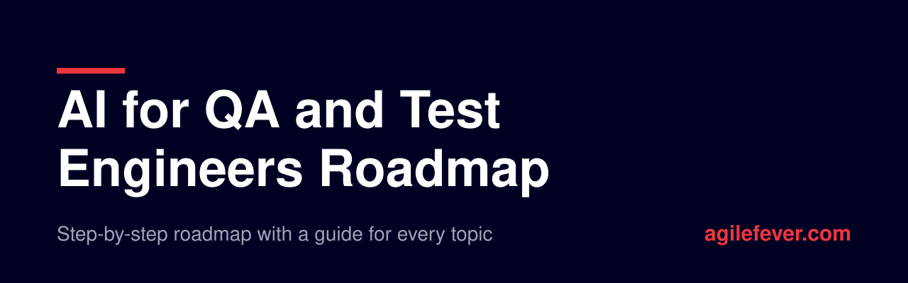

# AI for QA and Test Engineers Roadmap

> AI for QA and Test Engineers Roadmap - A step-by-step roadmap to use Gen AI and Agentic AI in testing, and to test the AI features your team ships, with a blog for every topic

## Table of Contents

- [Who is a QA and Test Engineer in the AI Era?](#who-is-a-qa-and-test-engineer-in-the-ai-era)
- [How to Use This Roadmap](#how-to-use-this-roadmap)
- [Step 0: Must Know](#step-0-must-know)
- [Step 1: Gen AI Basics for Testers](#step-1-gen-ai-basics-for-testers)
- [Step 2: Prompt Engineering and Context Engineering](#step-2-prompt-engineering-and-context-engineering)
- [Step 3: Where AI Fits in the QA Workflow](#step-3-where-ai-fits-in-the-qa-workflow)
- [Step 4: Test Plan and Test Case Generation](#step-4-test-plan-and-test-case-generation)
- [Step 5: Automation Scripts and Self-Healing Tests](#step-5-automation-scripts-and-self-healing-tests)
- [Step 6: Bug Report Generation](#step-6-bug-report-generation)
- [Step 7: AI Agents and Tool Use](#step-7-ai-agents-and-tool-use)
- [Step 8: Regression, Performance and Security Testing Agents](#step-8-regression-performance-and-security-testing-agents)
- [Step 9: Testing AI and LLM Features](#step-9-testing-ai-and-llm-features)
- [Step 10: Bug Triage and Quality Reporting Agents](#step-10-bug-triage-and-quality-reporting-agents)
- [Step 11: Career Path for AI-Era QA](#step-11-career-path-for-ai-era-qa)
- [Step 12: Certification and Next Steps](#step-12-certification-and-next-steps)
- [Learn This Roadmap with a Mentor](#learn-this-roadmap-with-a-mentor)
- [License](#license)

### Prepared and maintained by [AgileFever](https://agilefever.com)

### Follow AgileFever

- [LinkedIn](https://www.linkedin.com/company/agilefever/)
- [YouTube](https://www.youtube.com/@AgileFever)
- [X/Twitter](https://x.com/agilefever)
- [Website](https://agilefever.com)

## Learn with AgileFever

- [Gen AI and Agentic AI for QA and Test Engineers](https://agilefever.com/generative-ai/gen-ai-agentic-ai-for-qa-test-engineers/)

---

> **Note: We keep updating this roadmap with new topics and blogs.**

---

### Who is a QA and Test Engineer in the AI Era?

A QA or test engineer checks that software works before users find the problems. AI changes this job in two ways. First, AI helps us write test plans, scripts and bug reports faster. Second, many products now contain LLMs and agents, and these must be tested in a different way from normal software, because the same input can give different outputs.

In simple words, a QA engineer who works well with AI is:

- **A faster tester:** uses AI to draft test cases, scripts and bug reports, then reviews them.
- **An agent operator:** runs agents for regression, performance and security checks before a release.
- **An AI evaluator:** builds golden datasets and measures whether an AI feature is accurate, safe and stable.

This roadmap follows the same path: use AI in your testing first, then learn to test AI itself.

### How to Use This Roadmap

This roadmap is for people who already work in the role and want to use AI well in it. No machine learning background is needed.

- Follow the steps in order. Each step builds on the one before it.
- Inside each step, read the blogs in the given order. Every blog explains one idea in plain words.
- Topics without a link are practice areas. Try them on your own work, using any AI assistant you have access to.
- After every step, ask yourself: "Could I use this on my work tomorrow, and check the result before I trust it?" If yes, move on.
- Keep ownership of the output. AI drafts, you decide.

Let's get started.

### Step 0: Must Know

Before the details, learn the words that come up in every AI conversation at work. Each one is a short idea, and the rest of the roadmap builds on them. As a tester, you will also hear "golden dataset" and "LLM-as-judge", which we cover in Step 9.

- [LLM](https://agilefever.com/large-language-models-llm-guide/): the language model behind tools like ChatGPT and Claude
- [Prompt](https://agilefever.com/prompt-engineering-vs-context-engineering/): the instruction and context you give the model
- [Agent](https://agilefever.com/what-is-agentic-ai/): a model that plans steps and uses tools to finish a task
- [MCP](https://agilefever.com/model-context-protocol-explained/): a standard way to connect a model to tools and data
- [Evaluation](https://agilefever.com/evaluate-llm-application/): checking whether an AI output is correct and safe
- [AI glossary from A to Z](https://agilefever.com/artificial-intelligence-terms-ai-glossary-examples/)

### Step 1: Gen AI Basics for Testers

In this step, we learn what a language model is, what it is good at, and where it fails. A tester who knows why a model gives a wrong answer can design better checks for it.

- [Large Language Models (LLMs): A Complete Guide](https://agilefever.com/large-language-models-llm-guide/)
- [Agentic AI vs Generative AI: What is the Difference? (2026 Guide)](https://agilefever.com/agentic-ai-vs-generative-ai/)
- [What Is Agentic AI? A Complete Beginner’s Guide (2026)](https://agilefever.com/what-is-agentic-ai/)
- [ChatGPT vs Grok vs Gemini vs Claude vs Perplexity](https://agilefever.com/chatgpt-vs-grok-vs-gemini-vs-claude-vs-perplexity/)
- [Generative AI Courses in 2026: Where to Start with Right One](https://agilefever.com/generative-ai-courses/)

### Step 2: Prompt Engineering and Context Engineering

In this step, we learn to give the model clear instructions and the right context. For testers, this is how a feature spec becomes a useful test plan.

- [Prompt Engineering vs Context Engineering: What Changes in Practice](https://agilefever.com/prompt-engineering-vs-context-engineering/)
- Giving the model your own examples, standards and templates
- Asking for a format you can check, such as a table or a checklist
- Splitting a large task into small prompts and reviewing each result

### Step 3: Where AI Fits in the QA Workflow

In this step, we map the places where AI already helps testing teams, so we can pick where to start.

- [GenAI & Agentic AI Use Cases for QA and Test Engineers](https://agilefever.com/genai-agentic-ai-use-cases-qa-test-engineers/)
- [GenAI & Agentic AI Skills Every QA and Test Engineer Needs in 2026](https://agilefever.com/genai-agentic-ai-skills-for-qa-test-engineers/)
- [AI Tools for Software Teams: Where AI Helps in Coding, Testing, Docs and Ops](https://agilefever.com/ai-tools-for-software-teams/)
- [20 Use Cases for Generative AI and Agentic AI Across Every Agile Role](https://agilefever.com/generative-ai-agentic-ai-use-cases/)
- [GenAI & Agentic AI for QA and Test Engineers: The Complete Guide](https://agilefever.com/genai-agentic-ai-qa-test-engineers-complete-guide/)

### Step 4: Test Plan and Test Case Generation

In this step, we turn a feature specification into a test plan with positive, negative and edge cases. The goal is more coverage in less time, with a human reviewing every case.

- Feature spec to complete test plan
- Positive, negative and edge-case design
- Data-driven test design
- Reviewing AI-generated cases for gaps and duplicates
- [Use cases of Gen AI and Agentic AI for QA engineers](https://agilefever.com/genai-agentic-ai-use-cases-qa-test-engineers/)

### Step 5: Automation Scripts and Self-Healing Tests

In this step, we generate automation code from test cases and make it survive UI changes. We also learn to review generated code instead of pasting it blindly.

- Generating Selenium, Cypress and Playwright scripts from test cases
- Page Object Model with AI
- Self-healing locator patterns
- [Vibe code vs real code: how to review what AI writes](https://agilefever.com/vibe-code-vs-real-code/)
- [Gen AI use cases for back-end and front-end work](https://agilefever.com/18-use-cases-genai-agentic-ai-back-end-developer-role/)

### Step 6: Bug Report Generation

In this step, we turn logs, screenshots and reproduction steps into a bug report a developer can act on without asking questions.

- Failure logs and screenshots to a structured report
- Severity, priority and probable root cause
- Reproduction steps that others can follow
- [Kanban for software testing teams: bugs, retests and releases](https://agilefever.com/kanban-for-software-testing-teams/)

### Step 7: AI Agents and Tool Use

In this step, we learn how a model goes from answering questions to doing multi-step work with tools. For a tester, an agent is a helper that can run tests, read results and file tickets.

- [What Is Agentic AI? A Complete Beginner’s Guide (2026)](https://agilefever.com/what-is-agentic-ai/)
- [Agentic AI Architecture Explained: Planner, Memory, Tools, and Reflection](https://agilefever.com/agentic-ai-architecture-planner-memory-tools-reflection/)
- [Single-Agent vs Multi-Agent Systems: What’s the Difference? (2026 Guide)](https://agilefever.com/single-agent-system-vs-multi-agent-system/)
- [Model Context Protocol (MCP) Explained for Developers](https://agilefever.com/model-context-protocol-explained/)
- [AI Agent Frameworks Compared: LangGraph, CrewAI and AutoGen](https://agilefever.com/ai-agent-frameworks-compared/)
- [How To Start Learning AI Agents](https://agilefever.com/how-to-start-learning-ai-agents/)

### Step 8: Regression, Performance and Security Testing Agents

In this step, we use agents to run checks before every release. We keep a person in charge of what the agent is allowed to change.

- Regression agent: baseline comparison and failure analysis
- Performance and load testing agent
- OWASP Top 10 security testing agent
- [Prompt injection and guardrails: basic defenses for AI agents](https://agilefever.com/prompt-injection-guardrails/)
- Approval points: what the agent may run alone and what needs sign-off

### Step 9: Testing AI and LLM Features

In this step, we learn to test the AI inside a product. This is the new skill for QA: measuring answers that are not fixed.

- [How to evaluate an LLM application: test sets, rubrics and regression checks](https://agilefever.com/evaluate-llm-application/)
- Building a golden dataset
- LLM-as-judge compared with human raters
- DeepEval, RAGAS and Promptfoo
- Hallucination, drift and prompt injection testing
- [Prompt injection and guardrails](https://agilefever.com/prompt-injection-guardrails/)

### Step 10: Bug Triage and Quality Reporting Agents

In this step, we automate the repeated parts of triage and reporting so trends are visible without manual tracking.

- Classifying severity and routing bugs to the right team
- Duplicate bug detection
- Quality dashboards and trend reports
- [AI training for QA teams: a corporate learning path](https://agilefever.com/ai-training-for-qa-teams/)

### Step 11: Career Path for AI-Era QA

In this step, we look at how the QA role grows once you can test AI systems, and how to plan your learning.

- [QA Engineer to AI Test Engineer: A Career Transition Roadmap](https://agilefever.com/qa-engineer-to-ai-test-engineer-roadmap/)
- [AI Learning Plan for Working Professionals: 12 Weeks, 5 Hours a Week](https://agilefever.com/ai-learning-plan-for-working-professionals/)
- [Which AI Program Is Right for Experienced IT Professionals?](https://agilefever.com/which-ai-program-is-right-for-experienced-it-professionals/)
- [AI Skills Matrix for Engineering Teams: Who Needs Which Program](https://agilefever.com/ai-skills-matrix-for-engineering-teams/)

### Step 12: Certification and Next Steps

In this last step, we check what we have learned and decide how to prove it. Build one small project: a test plan, a script set and an evaluation run for an AI feature.

- [Is GenAI & Agentic AI for QA and Test Engineers Worth It?](https://agilefever.com/is-genai-agentic-ai-for-qa-test-engineers-worth-it/)
- [Course guide: Gen AI and Agentic AI for QA and Test Engineers](https://agilefever.com/genai-agentic-ai-qa-test-engineers-complete-guide/)
- Portfolio project: golden dataset plus an evaluation report for one AI feature

### Learn This Roadmap with a Mentor

If you want to follow this roadmap with a live instructor, hands-on labs and feedback, AgileFever runs a course built around the same topics. See [Gen AI and Agentic AI for QA and Test Engineers](https://agilefever.com/generative-ai/gen-ai-agentic-ai-for-qa-test-engineers/) for the curriculum and the next batch.

### License

This roadmap is licensed under CC BY 4.0. You may share and adapt it with credit to AgileFever.
